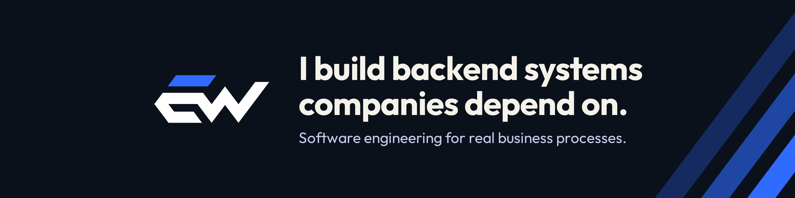

# Hi, I'm Eesa 👋

Senior Software Engineer at Gicoh, based in Lahore, Pakistan. My work centres on backend development in Python, particularly business logic and system integrations, with JavaScript for client-side features.

Most of my work lives in private company repos, so this page is quieter than my keyboard.

### 🛠️ What I work on

- **Business logic:** turning complex business rules and workflows into backend code, with validation that catches bad data early.
- **APIs and integrations:** REST APIs and data sync between separate systems, including message-based sync and background jobs.
- **Process digitisation:** moving spreadsheet and paper-based processes into proper systems.
- **Problem to production:** working with stakeholders on requirements, then building, deploying, and supporting the result.

### 🧰 Tech I reach for

#### Backend

  
  
  

#### Frontend

  
  
  
  

#### Data & infrastructure

  
  
  
  
  

#### Tools

  
  
  
  

#### Also worked with

  
  
  
  
  
  

### ⚡ Fun facts

- My favourite kind of request: "Can this Excel sheet become a real system?"
- Off the keyboard: table tennis, badminton, and padel (if there's a racket, I'm in), plus a good book.

### 🌐 Let's connect

